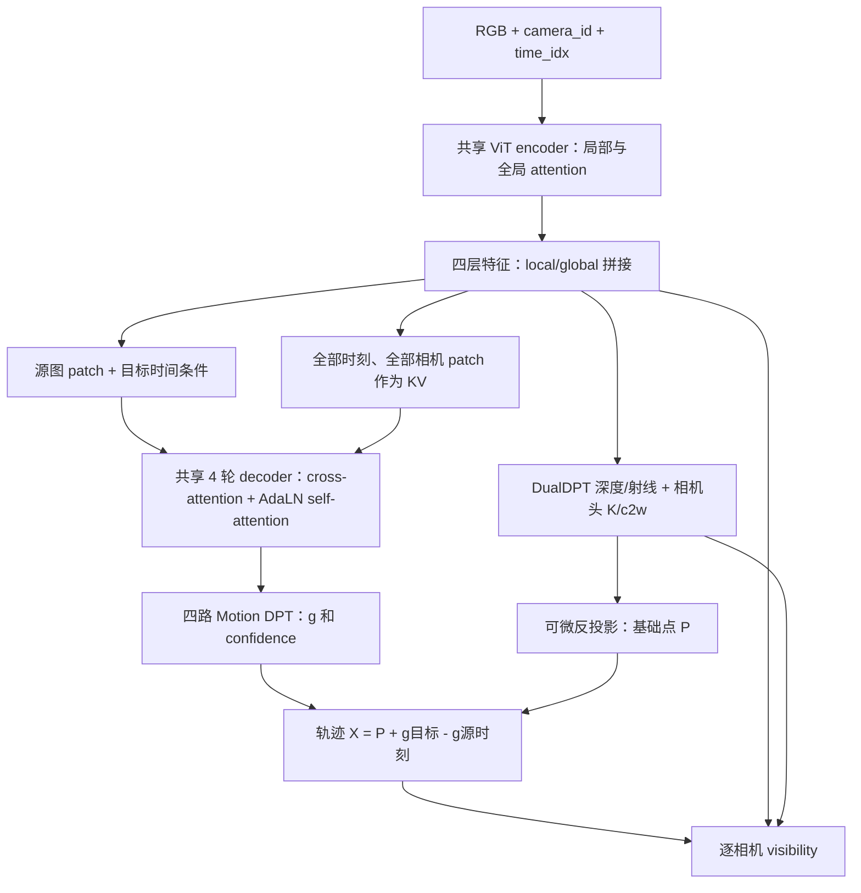

# MultiCamera4RC

面向**同步多相机、未知内外参**的 4D 模型，完成几何重建、scene flow 和三维点追踪。网络输入 RGB、相机身份和共享整数帧号；采用 **4RC 基础点 + 三维位移**，在统一场景坐标中输出轨迹及逐相机可见性。

当前发布版本为 **`v0.2.0`**，默认分支为 `main`。这是从 [bestzbf/my_dfrt](https://github.com/bestzbf/my_dfrt) 的 `codex/multicamera-4rc` 分支、提交 `404d4fdfe547574bb2cbfa6a283a1dae917c7a15` 导出的独立完整源码版本；发布范围和验证见[版本说明](releases/v0.2.0/README.md)。本仓库同时保留早期 D4RT 代码；本页及 `multicamera4rc/` 文档描述当前模型。旧 D4RT 的 VideoMAE 权重、`base/large/huge/giant` 配置和 `train_mixture.py` 用法见[历史文档](docs/legacy-d4rt.md)。两种模型的权重不能互换。

## 从哪里读起

| 文档 | 内容 |
|---|---|
| [模型结构与张量维度](docs/architecture.md) | 相机/时间如何编码、全部时刻 KV、AdaLN、基础点与位移、输出及版本兼容 |
| [数据与 GT 约定](docs/data.md) | 路径、动态监督来源、原分辨率、坐标归一化、混合采样、接入新数据 |
| [Syn4D 接入](docs/syn4d.md) | 原生多相机、网格稠密动态 GT、部分下载、混合配置与官方对照验证 |
| [训练、推理与验证](docs/training.md) | 完整命令、断点恢复、50k 课程、固定验证、显存策略 |
| [D4RT 单目评估适配](docs/monocular-evaluation.md) | Sintel Final 14、ScanNet test100、S/SS 深度、点云与位姿指标及尺度约定 |
| [55.5k 单目实测结果](multicamera4rc/audits/monocular_benchmark_20261008/README.md) | ScanNet 100/100、Sintel 14/14，完整逐场景结果、GT 审计和复现证据 |
| [代码组织与开发](docs/development.md) | 模块边界、测试入口、打包、历史代码、此次审查结论 |
| [本次框架验证记录](multicamera4rc/audits/framework_20261003/README.md) | 两地回归、真实 giant 前反向及兼容性边界 |
| [模型与训练质量审查](multicamera4rc/audits/quality_20261003/README.md) | 25k/30k 固定验证、时间原点敏感性、监督覆盖和优化顺序 |
| [质量恢复续训](multicamera4rc/audits/quality_recovery_20261003/README.md) | 布局回放、有效运动监督、时间/损失配对试验、验证选模与课程提升条件 |
| [50k 课程及实测证据](multicamera4rc/audits/variable_ct_20261003/README.md) | C1–C10、T4–T32、数据比例、GT/giant/DDP 预检记录 |

**版本说明：** 新建模型默认 `decoder_memory="all_observations"`、`time_origin="clip_start"`：decoder 读取全部输入观察，时间编码减去片段最早有效帧号并保留帧间隔。较早 native 断点恢复为其原有 `target_time`/`absolute` 语义；显式传入对应参数才迁移。32k→50k [质量恢复续训](multicamera4rc/audits/quality_recovery_20261003/README.md)保留 `target_time`，时间编码和损失通过独立配对试验选择；实际配置写入各自 checkpoint 和验证报告。旧权重直接切换 KV 的动态误差实测明显增加，参数兼容不等于效果兼容。

## 安装与快速验证

Python 3.10+；先安装适合本机 CUDA 的 PyTorch，CPU 也可运行 `tiny`。

```bash
git clone --branch v0.2.0 https://github.com/bestzbf/MultiCamera4RC.git
cd MultiCamera4RC
python -m venv .venv
source .venv/bin/activate
python -m pip install -e '.[data,test,weights]'

python -m pytest -q
python -m multicamera4rc demo --output outputs/smoke --train-steps 2
python -m multicamera4rc adapter-demo --output outputs/adapter_smoke --train-steps 2
```

两个 smoke 实际执行小模型训练、保存断点、恢复和推理；后者包含生成 H5、读取原生适配器。它们验证执行路径，不评估重建精度。`pytest` 默认只收集当前包的测试；历史测试可显式指定路径。

统一命令为 `python -m multicamera4rc {train,infer,evaluate,launch,demo,adapter-demo}`，安装后也可使用 `multicamera4rc`。例如 `python -m multicamera4rc train --help`。原有 `python -m multicamera4rc.train` 等入口继续可用。

## 模型怎样输入

```python
import torch
from multicamera4rc import MultiCamera4RC, MultiCamera4RCConfig, pack_synchronized_images

# B=1，C=2，T=3；浮点 RGB 在 [0,1]。H/W 是 14 的倍数且至少 28。
torch.set_num_threads(2)
images = torch.rand(1, 2, 3, 3, 28, 42)
batch = pack_synchronized_images(images, frame_indices=[0, 5, 10], camera_ids=[7, 9])
# images: [1,6,3,28,42]
# camera_id: [[7,7,7,9,9,9]]
# time_idx: [[0,5,10,0,5,10]]
# query_time_idx: [[0,5,10]]
model = MultiCamera4RC(MultiCamera4RCConfig.tiny()).eval()
with torch.inference_mode():
    pred = model(**batch, source_obs_idx=[0, 3])
assert pred['depth'].shape == (1, 6, 28, 42)
assert pred['trajectory'].shape == (1, 2, 3, 28, 42, 3)
assert pred['visibility'].shape == (1, 2, 3, 2, 28, 42)
```

`source_obs_idx=[0,3]` 选择两张参考图，解码这两张图上所有像素的轨迹；全部六张输入仍参与 encoder、几何预测和全时刻 KV。网络不输入 GT 内外参。相机 ID 表示“哪些帧来自同一台相机”；帧号保留采样间隔，不需要额外 timestamp。

## 核心结构



| 配置 | `giant` | `tiny` |
|---|---:|---:|
| patch | 14 | 14 |
| encoder 宽度 / 层数 / heads | 1536 / 40 / 24 | 64 / 8 / 4 |
| 四个全局层 tap（从 0 开始） | 19, 27, 33, 39 | 1, 3, 5, 7 |
| motion decoder 轮数 / heads | 4 / 16 | 4 / 4 |
| 几何 DPT 输入 / 运动 DPT 输入 | 3072 / 1536 | 128 / 64 |
| 用途 | 4RC 权重初始化与训练 | 完整结构的 CPU/回归验证 |

时间同时通过目标条件 token 和 AdaLN 输入 decoder；相机身份通过 encoder 全局 attention、decoder cross-attention 的同相机偏置输入。完整公式和维度变化见[模型文档](docs/architecture.md)。

## 开始训练与推理

先将数据 YAML 中的路径改为实际路径；以下是原生 Kubric 的示例，完整混合训练使用已审计的阶段 YAML。

```bash
# GPU 4/5、每卡 BS1；从原 4RC 权重初始化新模型。
python -m multicamera4rc launch \
  --gpus 4,5 --allow-shared \
  --data-config multicamera4rc/configs/kubric_multicam_native.yaml \
  --pretrained /path/to/4RC/model.safetensors \
  --decoder-memory all_observations \
  --batch-size 1 --source-count 4 --max-source-time-pairs 64 \
  --workers 0 --no-query-chunking \
  --steps 1000 --save-every 100 --output outputs/kubric_trial

python -m multicamera4rc infer \
  --data-config multicamera4rc/configs/kubric_multicam_native.yaml \
  --checkpoint outputs/kubric_trial/latest.pt \
  --source-obs 0 --max-clips 1 --device cuda --amp \
  --no-query-chunking --output outputs/predictions
```

训练步数、显存需求及学习率应按[训练文档](docs/training.md)配置。`--allow-shared` 允许与其他计算进程共卡；`--dry-run` 可打印 GPU 映射、数据摘要和最终启动参数。运行结果、GT 审计和大型权重写到 `outputs/` 或服务器指定目录，不进入 Git。

## 数据与监督

当前支持的数据包括 Kubric、DynamicReplica、PointOdyssey、vKITTI2、TartanAir V1/V2、Hypersim、ScanNet、ScanNet++、WildRGBD、BlendedMVS、Taskonomy 和 Syn4D；相机和时间长度联合采样。配比随恢复训练和新数据准入阶段变化，以运行中的 `data_config` 为准。各数据的目录和动态 GT 能力见[数据文档](docs/data.md)。

Kubric 稠密 GT 现采用 `dense_target_version=2`：按实例标签和世界地面方程排除 HDRI 穹顶，保留物体、可信地面和完整输入 RGB。过滤同时作用于所有相关监督与尺度归一化；旧 checkpoint 必须在新掩码下重新建立验证基线。策略与兼容方式见[数据与 GT 约定](docs/data.md)。

Syn4D 原生 EXR/MP4/safetensors 适配支持补齐的 560 份人体和 560 份衣服网格，详细用法见 [Syn4D 文档](docs/syn4d.md)，完整数据检查见 [2026-10-08 审计](multicamera4rc/audits/syn4d_20261008/README.md)。全量池覆盖 29 个 V1 场景和 8 个 Sim 场景，共 659 条训练、75 条验证、87 条测试序列；配比为旧数据 90%、V1 stride-1 5%、Sim 5%。从 55k 完整 checkpoint 恢复到 100k，保留原图、全有效像素监督及可变 C/T，人体和衣服区域加入真实三维运动监督。6 路缺少 tracking 的相机及 8 个缺失物体网格仍按明确清单处理，其他有效数据保留；人体/衣服缺失会阻止加载。实际启用状态和训练步数以服务器控制器 `progress.json` 及训练日志为准。

GT 独立复查、Syn4D 边界可见性修复及 BlendedMVS 回放调整见 [GT 与加载器审计](multicamera4rc/audits/gt_integrity_20261008/README.md)。该恢复配置保留全部来源，将旧数据内部的 BlendedMVS 比例从 3.6% 提到 8%，Syn4D V1/Sim 仍各为 5%；继续沿用固定验证和原质量门槛。

2026-10-08 的[验证面板迁移](multicamera4rc/audits/blended_validation_migration_20261008/README.md)已将正式 BlendedMVS 验证从 2 个场景扩展到全部 26 个留出场景、52 个固定组合，静态验证总计 60 个组合。45k/53k/55k 基线已按同一计划重算，控制器拒绝混用不同验证范围。GPU2/3/4/5 的在途训练进程保持运行，下一次 55,500 步验证使用新面板，目标仍为 100k；具体进度以服务器实时记录为准。

已配置[55.5k 学习率试验](multicamera4rc/audits/lr_trial_20261008/README.md)：该边界通过新面板且指标稳定时，两组 LR 用 100 步升至断点 LR 的 1.5 倍，56k 复核。未达标先从完整 55.5k 断点恢复原 LR 计划；当前四卡在途训练及采样进度继续保留。部署完成时尚未触发升 LR，实际状态以控制器 `learning_rate_trial.json` 为准。

`image_mode: native` 保持文件中 RGB 的原像素与长宽比，只向右/下补齐 patch14。几何使用全部有效像素；选定源图的运动使用全部有效稠密 GT，PointOdyssey 使用全部有效原生粒子 GT，无 4096 条查询上限。未知运动、padding、缺失视角通过独立 mask 排除，缺失三维轨迹不会被填成静止标签。

## 来源与许可

保留原 4RC 模块层级和参数形状；`vendor/` 的来源、修改及许可见 [NOTICE](multicamera4rc/vendor/NOTICE)、[UPSTREAM](multicamera4rc/vendor/UPSTREAM.json)、[S-Lab 许可](multicamera4rc/vendor/LICENSE.S-Lab) 和 [Apache-2.0 许可](multicamera4rc/vendor/LICENSE.Apache-2.0)。新增多相机结构是本项目实现，需要独立验证，不能视为原论文已验证的能力。没有将旧 D4RT 下载权重列为当前多相机模型的已训练权重。
