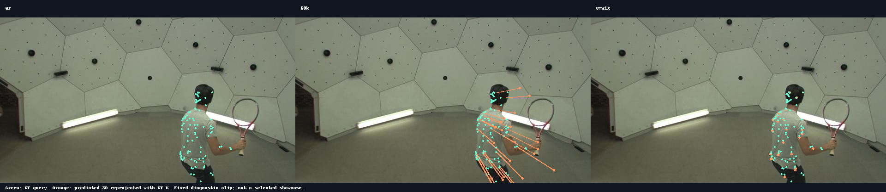

# PStudio 指标复核：评分适配与首帧几何

检查对象是已发布、固定的 MultiD4RT 60k 权重，严格加载完整模型。
没有更换权重、删掉测试视频、丢弃困难查询或向正式推理提供 GT 内参。
另外对训练端 67k 做了四个预先固定片段的诊断；这不是完整 67k 测试。

## 已修复的评分适配错误

官方 `evaluate_model.py` 在调用 `metrics.py` 前，将标注内参乘以
`256 / min(original_height, original_width)`。之前的适配只调用了
`metrics.py`，漏掉调用端的归一化。

PStudio 原图为 360×640，因此缩放因子是 `256/360`。旧评分中的距离
阈值比官方协议严格 1.40625 倍。这一步只影响评分阈值；模型的 RGB
输入、实际预测、GT 三维坐标以及 EPE 的米制单位均不改变。

| 完整 full_eval：106 视频，954 个 T16 片段 | 60k | OmniX release |
|---|---:|---:|
| 修复前 APD3D，已作废 | 3.2823% | 13.9657% |
| 修复后 APD3D | **6.6445%** | **21.3096%** |
| EPE，未改变 | 22.7129 cm | 12.7940 cm |

全部 1,908 份原始预测原样复用并记录哈希；逐视频 GT/RGB 文件、查询
点 ID 与起始时间均核验，双方输入仍完全一致。旧报告已归档至
`tapvid16_pstudio_full_eval/legacy_raw_intrinsics`。

除了简单的 GT 恒等检查，还执行了原版官方 `evaluate_data_source`
函数本体，核对一个 8 mm 非零误差案例与双方八个真实缓存片段。
恒等检查无法发现这类阈值归一化错误，新的回归案例可以。

官方来源：
[TAPVid-3D 调用端](https://github.com/google-deepmind/tapnet/blob/730cda1c730877cfedbe01bf87fb1cadb78a565d/tapnet/tapvid3d/evaluation/evaluate_model.py#L201)、
[评分函数](https://github.com/google-deepmind/tapnet/blob/730cda1c730877cfedbe01bf87fb1cadb78a565d/tapnet/tapvid3d/evaluation/metrics.py)。

## 剩余差距的已验证原因：基础点的焦距偏差

所有 954 个片段的首帧稠密三维点可以反推出有效成像射线。
MultiD4RT 的拟合重投影 RMSE 均值仅约 0.004/0.003 像素，说明采样
点符合模型自己的针孔几何；四个真实网络输出进一步确认拟合焦距与
实际 camera head 的差异最多 0.022%。

| 完整 954 片段的诊断量 | 60k | OmniX |
|---|---:|---:|
| 有效焦距 / GT 焦距，x 方向均值 | 0.8049 | 0.9647 |
| 有效焦距 / GT 焦距，y 方向均值 | 0.7905 | 0.9621 |
| x 方向有效焦距低于 GT 的 90% 的片段数 | 794 / 954 | 246 / 954 |
| 首帧三维点 EPE | 22.5074 cm | 13.0509 cm |
| 后续相机坐标中的位移增量误差 | 4.7976 cm | 4.2591 cm |

这里 OmniX 的有效焦距是对射线几何的近似拟合，不等于其 camera token
head 的焦距。其发布配置用 `ray_origin + depth * ray_direction` 生成
基础三维点；MultiD4RT 用预测深度和预测 K 进行针孔反投影。

对于 MultiD4RT，首帧局部坐标满足

```text
P0 = depth * [(u-cx)/fx, (v-cy)/fy, 1]
X(t) = base_point + displacement(t)
displacement(source_time) = 0
```

当焦距偏小约 20% 时，相同像素的横向三维偏移会被放大约 25%。
整体尺度对齐无法同时修复 x/y 与 z 的比例。首帧位移被约束为零，
运动解码器也无法补偿基础点的这部分误差。

## 因果干预与排除项

在看指标之前，按照冻结计划索引 `0,318,636,953` 固定选取：
`tennis_18_0000`、`juggle_26_0048`、`boxes_18_0096`、
`softball_16_0128`。

仅在诊断中将初始点的射线替换成 GT K，保留预测深度、所有世界坐标
运动与所有目标帧的预测相机位姿，再用相同官方评分规则重新计算：

| 四个固定片段的干预实验 | APD3D | EPE |
|---|---:|---:|
| 60k 正常推理 | 1.2206% | 26.6808 cm |
| 60k：仅 GT 首帧 K 的诊断干预 | 32.4992% | 8.0377 cm |
| 67k 正常推理 | 1.1599% | 24.7511 cm |
| 67k：仅 GT 首帧 K 的诊断干预 | 33.0759% | 7.5987 cm |

**干预使用了 GT，不能当作模型成绩，也不能与完整 106 视频平均混用。**
这些结果说明相机内参误差是这组失败案例的主要原因，并且 67k 尚未
解决。残余误差还包含深度形状、运动与相机位姿误差。

全量缓存中的另一项诊断是直接消除初始三维点误差，保留各片段原有
尺度与预测的后续增量。此时 60k 的 EPE 为 4.47 cm，OmniX 为 3.97 cm；
APD3D 分别为 52.10% 与 56.03%。这同样是 GT 诊断，不是正式成绩。

已检查：

- 原始尺寸 360×640 保比例输入与 280×504 patch 网格输入，均未消除
  焦距偏差。分辨率会影响个别案例，但不足以解释整体差距。
- 首帧坐标变换后 z 与采样深度一致；R/t 在自己的源相机中抵消，
  没有发现 c2w/w2c 颠倒、单位转换或重复归一化。
- 发布模型与训练模型的可执行结构一致；geometry、motion、visibility
  文件哈希一致，model/config 只存在名称与说明文字差异。
- 原图外的查询约 0.139%，准备后的输出网格外约 0.035%，不是大面积
  越界采样造成的退化；没有用这些比例删掉任何正式评测点。
- 官方原始 `queries_xyt` 的部分时间标注异常另有审计，本轮固定 T16
  协议从对应首帧 XYZ 生成查询，不使用该字段。

多相机 MVTracker 的协议提供初始三维查询并对齐其位置，而单目
PStudio 只提供二维查询，必须由模型自行恢复基础三维点。因此前者
表现较好不能证明单目初始几何也已经可靠。

## 当前权重与建议优先级

检查时训练端最新已保存权重为 67,000 步；最近完整训练验证面板通过
的版本为 66,000 步。GPU 2–5 继续训练到 68k，并按控制器计划向后续
目标推进。魔搭发布与本次完整对比仍固定为 60k。

优先优化独立验证集上的单目首帧几何：增加 focal ratio 与 source EPE
监控，检查不同输入分辨率的内参泛化，加强内参与射线的一致性，以及
同一物理相机跨帧的 K 一致性。仅增加 decoder 的时间 KV 或继续数千
步训练，对首帧已经固定的基础点误差没有直接补偿。

PStudio GT 用于上述干预和诊断，不能据此拟合固定焦距修正系数并将
其宣称为未标定模型的正式提升。训练架构和现有训练任务在本次检查
中没有更改。

## 可复核文件

- [全量分解](cached/cached_decomposition.json)
- [真实网络输出、分辨率控制、GT K 干预](head_verification.json)
- [独立官方调用端回归核验](official_caller_parity/proof.json)
- [训练与发布模型源码一致性](training_release_source_parity.json)
- [首帧重投影可视化](source_reprojection.png)



绿色点是 GT 查询位置，橙色点/线是模型三维点通过 GT K 重投影的位置。
三幅图使用相同 RGB 和相同查询；此图用于暴露几何误差，不是挑选的
优秀案例。
